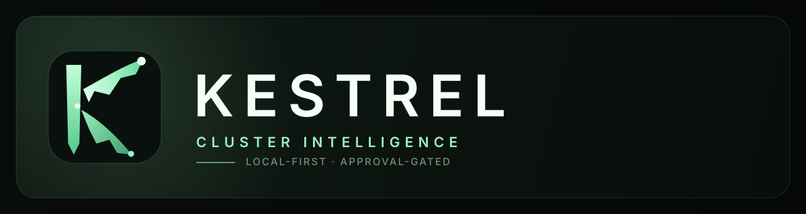
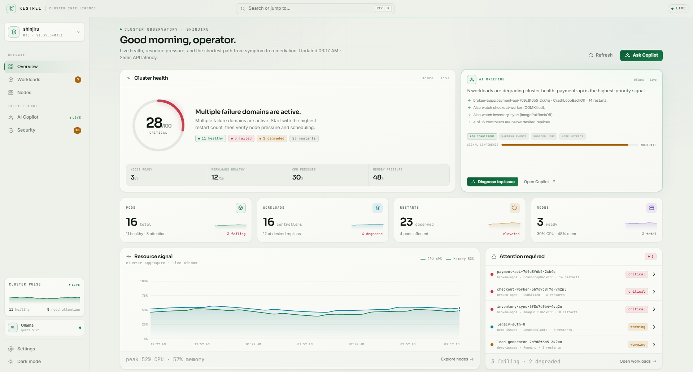
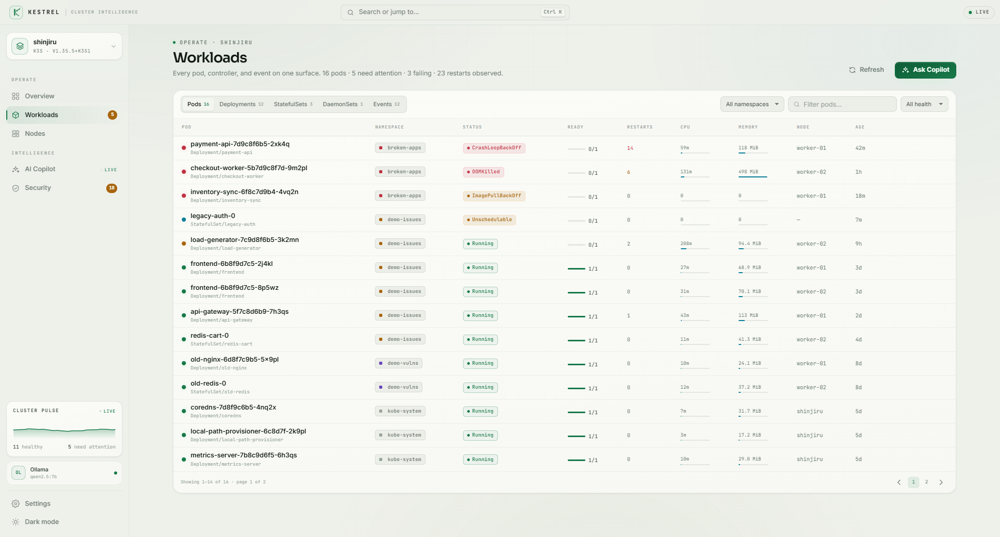
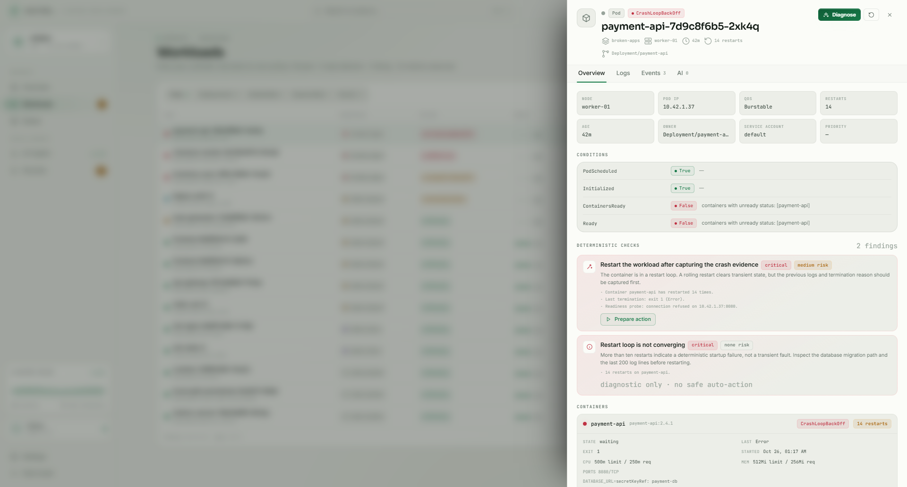
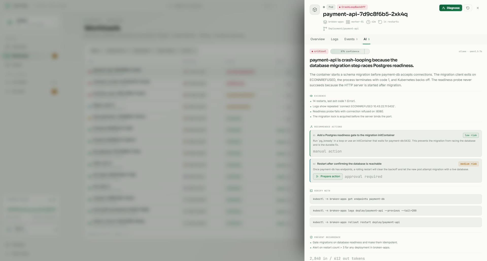
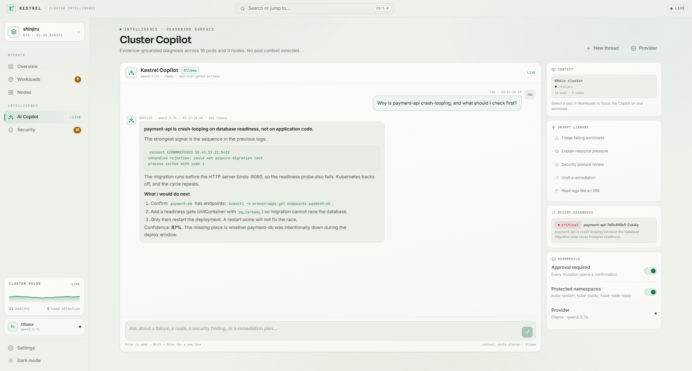
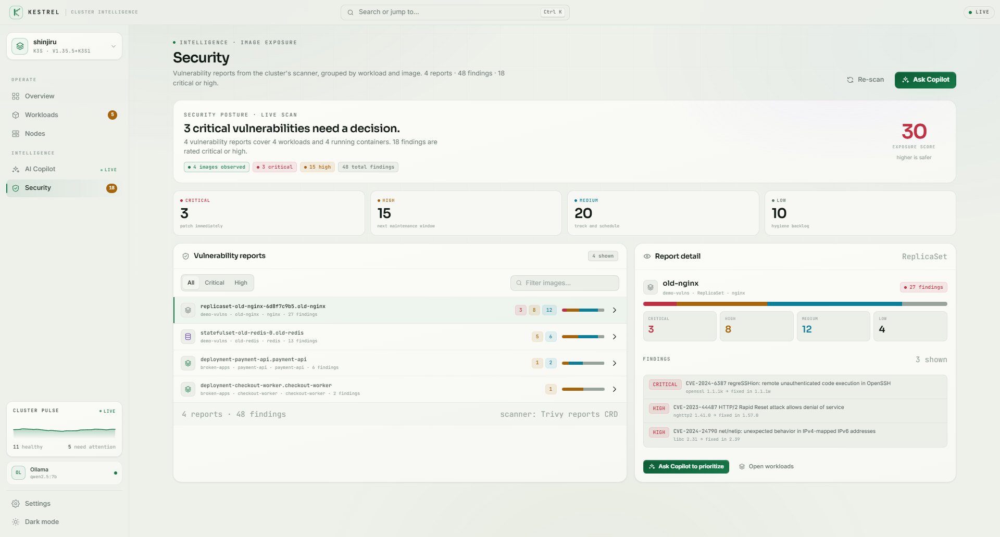
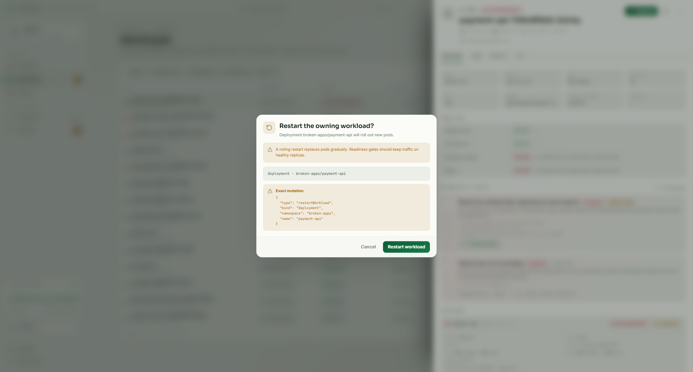
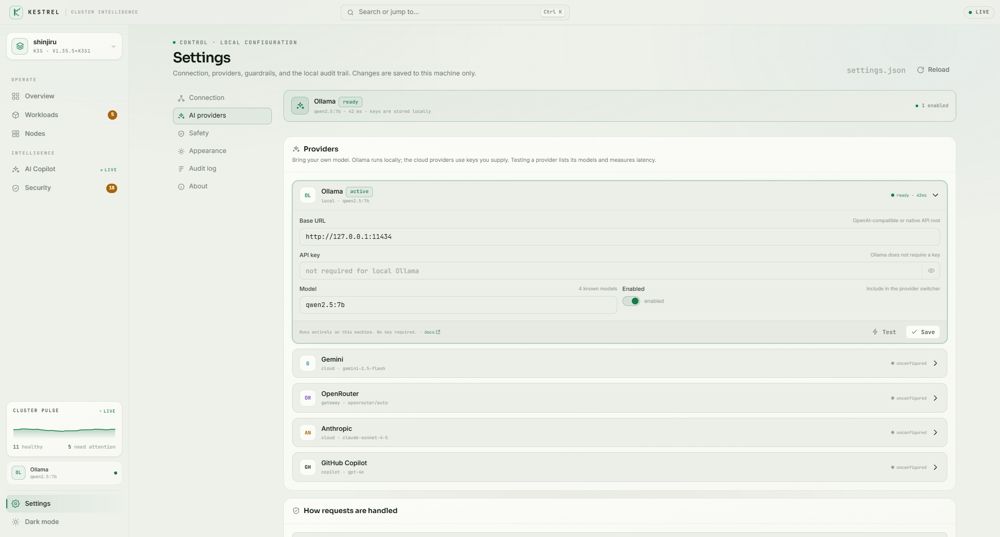
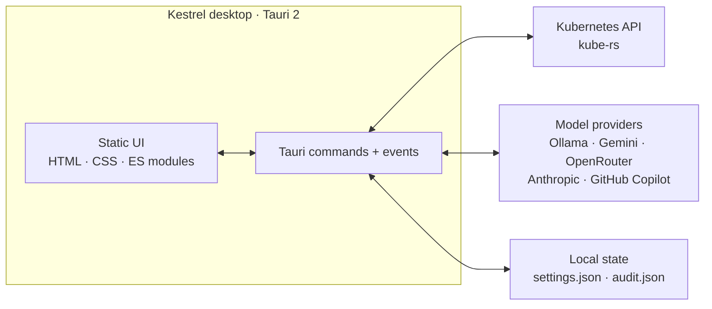

<p align="center">
  
</p>

<p align="center">
  <strong>Cluster intelligence with a human in the loop.</strong><br>
  <sub>Live observability, evidence-grounded AI diagnosis, and approval-gated remediation for Kubernetes.</sub>
</p>

<p align="center">
  <a href="https://github.com/Shinjiru-stack/kestrel/releases/latest"><strong>Download for Windows, Linux, or macOS</strong></a>
  &nbsp;·&nbsp;
  <a href="#using-kestrel">How to use</a>
  &nbsp;·&nbsp;
  <a href="#requirements">Prerequisites</a>
</p>

<p align="center">
  <a href="https://github.com/Shinjiru-stack/kestrel/actions/workflows/ci.yml"></a>
  
  
  
  
  
  
  
  
</p>

Kestrel is a cross-platform desktop app for Kubernetes operators who want the whole picture without handing a model the keys. It reads a kubeconfig, speaks directly to the API server, and turns a live cluster snapshot into a ranked, evidence-backed diagnosis. Every mutation is prepared as an exact payload, shown for approval, and written to a local audit trail. Native builds are produced for Windows, Linux, and macOS.

It is built with a Rust backend and a static HTML/CSS/vanilla-ES-module frontend inside Tauri 2. There is no Node.js runtime, React, bundler, or web server in the shipped app.

> Screenshots below use Kestrel's built-in preview dataset with deliberately broken demo workloads, shown in the default light theme. The same views render live cluster data when the desktop app is connected.

## Why Kestrel

- **Evidence before inference.** Deterministic checks run before a model is called: OOM kills, crash loops, image-pull failures, missing config, scheduling failures, evictions, probe failures, and warning events. The model receives bounded evidence, not a vague prompt.
- **The human stays in command.** Kestrel never remediates on its own. It prepares a typed action, renders the exact JSON, explains the risk, and waits. Destructive actions are off by default and require typing the resource name.
- **Local-first by construction.** Cluster credentials and provider keys stay on the machine. The UI has no direct network access; the Rust core talks to the Kubernetes API and the provider endpoint you configure.
- **One surface, no build step.** Overview, workloads, pod inspector, Copilot, security posture, settings, and audit live in one frameless desktop window. The frontend is embedded at build time.

## Screens

<p align="center">
  
  <br>
  <sub><strong>Overview.</strong> Live health, resource pressure, the AI briefing, and the workloads that need attention first.</sub>
</p>

### Workloads and the pod inspector

The workloads table puts failed and pending pods first, then ranks the rest by health and restart pressure. Filter by namespace, health, or free text; open any row without leaving the page.

<p align="center">
  
  <br>
  <sub><strong>Workloads.</strong> Failed and pending pods sort first; namespace, health, and text filters narrow the table.</sub>
</p>

The pod drawer is the working surface for a single workload. It combines conditions, deterministic findings, container state and resources, current and previous-container logs, events, and AI diagnosis. Logs can be searched, copied, or downloaded; secret-looking JSON fields and bearer tokens are redacted by default before display or model context.

<p align="center">
  
  <br>
  <sub><strong>Pod inspector.</strong> Conditions, deterministic findings, containers, logs, events, and AI diagnosis in one drawer.</sub>
</p>

### Evidence-grounded diagnosis

Diagnosis is a structured exchange, not a chat transcript. Kestrel asks the active provider for a strict JSON object, then parses and sanitizes it before rendering. The result shows severity, confidence, root cause, evidence, recommended actions with risk levels, a verification command, and a prevention note. The model and token usage are visible, and the raw response is always available.

If the model proposes an action, Kestrel checks it against the selected pod, its owner, and the safety policy. The action is a proposal until you approve it.

<p align="center">
  
  <br>
  <sub><strong>Diagnosis.</strong> A focused root cause, the evidence behind it, bounded actions, a verify command, and a prevention note.</sub>
</p>

### Cluster Copilot

Copilot is the conversational layer over the same live snapshot. Ask about the whole cluster or focus on one pod; the context panel shows exactly what the model can see. Prompt suggestions are generated from the current failures, not hard-coded demos. Recent diagnoses remain in the sidebar, and the guardrails panel states what the model will not do.

<p align="center">
  
  <br>
  <sub><strong>Copilot.</strong> Whole-cluster or pod-scoped chat, streaming answers, recent diagnoses, and a visible guardrail boundary.</sub>
</p>

### Security posture

Kestrel reads Trivy Operator `VulnerabilityReport` custom resources and groups findings by workload and image. The exposure score, severity totals, per-report CVE counts, and affected containers are all derived from the cluster's scanner output. **Re-scan** refreshes the reports; **Ask Copilot** hands the current exposure summary to the assistant.

Kestrel does not bundle a scanner. Without Trivy Operator, the Security view is intentionally empty.

<p align="center">
  
  <br>
  <sub><strong>Security.</strong> Image exposure, severity totals, an exposure score, and per-workload vulnerability reports.</sub>
</p>

### Approval-gated remediation

Every mutation follows the same path: prepare, inspect, confirm, validate, apply, audit. The approval modal shows the target, risk, and exact JSON payload. Destructive actions require typing the resource name. The Rust backend independently rejects protected namespaces and destructive actions when the Safety setting is off; the UI is not the only guardrail.

Supported actions are restart workload, delete pod, patch image, patch resources, and scale workload. Rollback is reserved in the action model but is not enabled in this build.

<p align="center">
  
  <br>
  <sub><strong>Approval.</strong> The exact mutation and its blast radius are shown before anything reaches the API server. Destructive actions also require typing the resource name.</sub>
</p>

### Settings that stay local

Providers, safety policy, appearance, audit, and the About panel live under Settings. Each provider has a base URL, model, optional key, enabled state, and a **Test** action that lists models and measures latency. Selecting **Use** makes a provider active for diagnosis and chat.

<p align="center">
  
  <br>
  <sub><strong>Providers.</strong> Bring your own model: Ollama locally, or Gemini, OpenRouter, Anthropic, and GitHub Copilot with your keys.</sub>
</p>

## Architecture



| Layer | Technology | Responsibility |
| --- | --- | --- |
| Desktop shell | Tauri 2 / WebView2 | Native window, IPC, CSP, bundle |
| UI | HTML, CSS, vanilla ES modules | Static, embedded at build time, no bundler |
| Core | Rust 2024 | Cluster snapshots, deterministic checks, AI adapters, safety, audit |
| Cluster | `kube` 4.2 / `k8s-openapi` 0.28 | Discovery, pods, workloads, events, metrics, logs, patches |
| AI transport | `reqwest` 0.13 / rustls | Provider APIs, streaming, model discovery |
| State | `serde` JSON | Local settings and audit trail |

The frontend has no direct network access. Its CSP allows scripts, styles, images, fonts, and Tauri IPC from the app origin; cluster and provider traffic goes through Rust. The UI polls the snapshot every 20 seconds while visible and refreshes on focus; AI streaming output arrives as the `ai://delta` Tauri event.

## Quick start

### Requirements

To install a release:

- **Windows 10/11** with the WebView2 Runtime (present on current Windows builds).
- **Linux x64**: Ubuntu 22.04+ or Debian 12+ with WebKitGTK 4.1, or a distribution that provides it. The AppImage is portable, but it still uses the host WebKitGTK and GTK 3 libraries.
- **macOS 11+** on Intel or Apple Silicon.
- A Kubernetes cluster and a kubeconfig reachable from this machine.
- Optional: Ollama for a fully local model, or an API key for a cloud provider.

To build from source, you also need:

- Rust 1.90+.
- **Windows:** Visual Studio 2022 Build Tools with **Desktop development with C++** and the MSVC Rust toolchain.
- **Linux:** `build-essential`, `pkg-config`, `libwebkit2gtk-4.1-dev`, `libayatana-appindicator3-dev`, `librsvg2-dev`, `libgtk-3-dev`, `libxdo-dev`, and `patchelf`. The CI workflow installs the complete list.
- **macOS:** Xcode Command Line Tools.
- Node.js is not required; the UI is static and embedded at build time.

### Install the release

Download the latest build from [Releases](https://github.com/Shinjiru-stack/kestrel/releases/latest). Asset names include the version and platform:

**Windows**

- `Kestrel_0.1.1_x64-setup.exe` — NSIS installer, recommended
- `Kestrel_0.1.1_x64_en-US.msi` — WiX/MSI installer

**Linux**

- `kestrel_0.1.1_amd64.deb` — Debian/Ubuntu package
- `kestrel-0.1.1-1.x86_64.rpm` — Fedora/RHEL package
- `Kestrel_0.1.1_amd64.AppImage` — portable executable

**macOS**

- `Kestrel_0.1.1_aarch64.dmg` — Apple Silicon
- `Kestrel_0.1.1_x64.dmg` — Intel

Run the installer and launch **Kestrel**. The first window is 1500 × 960, frameless, centered, and resizable down to 1180 × 720. It opens on **Overview** and connects using the kubeconfig it finds.

The builds are not code-signed. Windows SmartScreen may warn on first launch. On macOS, Control-click the app and choose **Open** the first time, or remove the quarantine attribute:

```bash
xattr -dr com.apple.quarantine /Applications/Kestrel.app
```

On Linux, install the `.deb` or `.rpm` with your package manager. For the AppImage:

```bash
chmod +x Kestrel_0.1.1_amd64.AppImage
./Kestrel_0.1.1_amd64.AppImage
```

### Build and run

```bash
git clone https://github.com/Shinjiru-stack/kestrel.git
cd kestrel

cargo build -p kestrel
cargo run -p kestrel
```

On Windows the binary is `target\debug\kestrel.exe`; on Linux and macOS it is `target/debug/kestrel`.

### Connect a cluster

Kestrel reads a kubeconfig from disk and speaks directly to the API server. It does not create a tunnel, port-forward, or proxy. If the API server is only reachable through an SSH tunnel or a WSL bridge, establish that outside the app and point the kubeconfig at the forwarded endpoint.

The default path order is:

1. `KUBECONFIG` (first path if the value contains a list; `;` on Windows, `:` on Linux and macOS)
2. `~/.kube/k3s-healer.yaml` (`%USERPROFILE%\.kube\k3s-healer.yaml` on Windows)
3. `~/.kube/config` (`%USERPROFILE%\.kube\config` on Windows)

Set a different file or context in **Settings → Connection**, then choose **Save & connect**. Leave the context blank to use the kubeconfig's current context. The API endpoint is observed from the active kubeconfig after connecting.

Kestrel stores settings and the audit trail in the platform app-data directory:

| Platform | Directory |
| --- | --- |
| Windows | `%APPDATA%\com.kestrel.desktop` |
| Linux | `~/.local/share/com.kestrel.desktop` |
| macOS | `~/Library/Application Support/com.kestrel.desktop` |

### Updates

Kestrel checks the public GitHub release feed once per launch. You can also run a check from **Settings → About → Check now**. When a newer release exists, a mint **Update** pill appears in the title bar; it opens the release notes and the GitHub release page. Kestrel does not download or install updates silently, does not run an update daemon, and does not use a private update server. If GitHub is unreachable or rate-limited, the check reports the error in Settings and cluster work continues normally.

### Use a local model

```powershell
ollama pull qwen2.5:7b
ollama serve
```

Open **Settings → AI providers**, select Ollama, and confirm the base URL (`http://127.0.0.1:11434`) and model. No API key is required. Ollama is the default provider so a fresh install can work without a cloud account.

### Use a cloud provider

Open **Settings → AI providers**, choose a provider, paste a key, pick a model, and press **Test** to list models and measure latency. Press **Save**, then **Use** to make it active. Keys are stored locally in `settings.json` in the platform app-data directory, in plaintext; see [Security notes](#security-notes).

## Using Kestrel

Kestrel is read-only until you approve a mutation. A typical session:

1. **Connect.** On launch, Kestrel tries the default kubeconfig. If the header does not show **LIVE**, open **Settings → Connection**, choose the kubeconfig and context, and select **Save & connect**. See [Connect a cluster](#connect-a-cluster). The interface starts in light mode; **Settings → Appearance** switches to dark mode.
2. **Read the overview.** The health score, node and workload pressure, restart count, AI briefing, and **Attention required** queue tell you where to start. Select a row to open it.
3. **Inspect the failure.** Open **Workloads**, filter by namespace or health, and select a pod. The drawer shows conditions, deterministic findings, containers, current and previous-container logs, and events. Use previous-container logs after a restart.
4. **Diagnose.** In the drawer's **AI** tab, select **Run diagnosis**. Review severity, confidence, evidence, recommended actions, the verification command, and prevention notes. The raw model output and token usage are available.
5. **Ask Copilot.** Open **AI Copilot** for whole-cluster or pod-scoped questions. Prompt suggestions follow the current failures, and the context panel shows what the model can see.
6. **Review security.** Open **Security** to see Trivy Operator reports, severity totals, exposure score, and affected images. **Re-scan** refreshes the reports; **Ask Copilot** sends the current summary to chat.
7. **Approve a remediation.** From a diagnosis or the pod drawer, choose a recommended action, review the exact JSON payload and blast radius, and confirm. Destructive actions require typing the resource name and are disabled by default in **Settings → Safety**.
8. **Check the audit trail.** **Settings → Audit log** shows every requested mutation and its outcome. The same record is stored in the platform app-data directory (`audit.json`); see [Connect a cluster](#connect-a-cluster) for the path on each platform.

Use `Ctrl K` for the command palette, `Ctrl R` to refresh, and `?` for the shortcut sheet. The full key map is [below](#keyboard).

## Providers

| Provider | Default endpoint | Auth | Default model | Notes |
| --- | --- | --- | --- | --- |
| Ollama | `http://127.0.0.1:11434` | None | `qwen2.5:7b` | Local-first; any pulled model works |
| Google Gemini | `https://generativelanguage.googleapis.com/v1beta` | API key | `gemini-2.5-flash` | Key from Google AI Studio |
| OpenRouter | `https://openrouter.ai/api/v1` | API key | `openrouter/auto` | OpenAI-compatible gateway |
| Anthropic | `https://api.anthropic.com/v1` | API key | `claude-sonnet-4-5` | Messages API; custom base URL supported |
| GitHub Copilot | `https://api.githubcopilot.com` | GitHub token | `gpt-4o` | Token exchange at `api.github.com`; falls back to GitHub Models |

Base URL and model are editable per provider. A compatible proxy or gateway can be used by changing the base URL; Kestrel does not ship or manage one. Model quality, quotas, and network access are the provider's responsibility.

## Safety model

Kestrel is read-only until you explicitly approve an action.

1. **Snapshot.** The Rust core reads nodes, pods, workloads, events, metrics, and vulnerability reports.
2. **Deterministic checks.** The healer analyzes pod status, container state, conditions, and warning events for OOM kills, crash loops, image-pull failures, config errors, pending/unschedulable pods, evictions, probe failures, failed phases, and warning-only instability.
3. **Diagnosis.** The active model receives bounded evidence and returns a structured diagnosis. Its output is parsed and sanitized; proposed actions are checked against the selected pod, its owner, and the safety policy.
4. **Approval.** The UI renders the exact mutation payload. Destructive actions require typing the resource name.
5. **Validation.** The Rust backend rejects protected namespaces, disabled destructive actions, negative replica counts, and malformed actions.
6. **Apply and audit.** The mutation is applied through the Kubernetes API and the result is appended to the local audit trail.

Default guardrails:

- Protected namespaces: `kube-system`, `kube-public`, `kube-node-lease`. The backend enforces this, not only the UI.
- Destructive actions: **off by default**. Enable them in **Settings → Safety** if you need pod deletion. Even then, the approval modal requires the exact resource name.
- Memory ceiling: 1024 MiB for generated OOM resource patches; OOM patch count is capped at 3 before Kestrel stops suggesting another increase.
- Replica count: negative values are rejected.
- Log redaction: best-effort removal of secret-looking JSON fields and bearer tokens before logs are displayed or sent as model context. This is not a substitute for keeping secrets out of logs.
- Audit: every requested mutation and its outcome is written to `audit.json` in the platform app-data directory. This is a local application record, not Kubernetes API-server audit logging.
- No autonomous loop: Kestrel has no controller, watcher, or background mutation worker. Nothing changes without an approval.

The model is advisory. Evidence and the exact mutation are the source of truth.

## Keyboard

| Shortcut | Action |
| --- | --- |
| `Ctrl K` | Open or close the command palette |
| `Ctrl R` | Refresh the cluster snapshot |
| `G` then `O` | Go to Overview |
| `G` then `W` | Go to Workloads |
| `G` then `N` | Go to Nodes |
| `G` then `C` | Go to Copilot |
| `G` then `S` | Go to Security |
| `G` then `,` | Go to Settings |
| `?` | Show the shortcut sheet |
| `Esc` | Close a modal, the palette, or the pod drawer |
| `Enter` | Send a Copilot message |
| `Shift Enter` | Insert a newline in Copilot |

## Project layout

```text
crates/
  kestrel-core/            Rust domain layer
    src/kube_client.rs     Cluster client, snapshots, logs, metrics, security reports, mutations
    src/ai.rs              Provider adapters, streaming, diagnosis parsing, action sanitizing
    src/healer.rs          Deterministic pod checks and remediation suggestions
    src/models.rs          Serializable domain models
    src/settings.rs        Settings model, provider defaults, kubeconfig discovery
    src/updates.rs         GitHub release check and semantic version comparison

  kestrel/                 Tauri 2 desktop shell
    src/commands.rs        Commands, safety enforcement, audit, event streaming
    src/state.rs           Shared application state
    src/lib.rs             App setup and legacy app-data migration
    ui/                    Static HTML/CSS/ES-module frontend
    tauri.conf.json        Product metadata, window, CSP, bundle

docs/
  BRAND.md                 Brand system and voice
  brand/                   Mark, icon, lockup, social card, source HTML
  screenshots/             Product screenshots

tools/
  preview-server.mjs       Static UI preview with mock data
  provider-mock.mjs        Local fake provider for adapter tests
  cdp-existing.mjs         WebView2 CDP screenshot/eval harness
  make-icons.ps1           Regenerates PNG/ICO app icons from the mark
  evals/                   Development-only UI verification scripts
```

Tauri embeds `crates/kestrel/ui/` at build time. After changing HTML, CSS, or JavaScript, rebuild and relaunch the app; a browser refresh is not enough.

## Development

```bash
# Formatting, lint, and build checks
cargo fmt --all -- --check
cargo clippy --workspace --all-targets -- -D warnings
cargo build -p kestrel

# Workspace tests
cargo test --workspace
```

### Static UI preview

The frontend can run in a normal browser with mock data:

```powershell
node tools/preview-server.mjs
```

Open <http://127.0.0.1:4173>. The preview uses `ui/js/mock.js` and does not contact a cluster or a model provider.

### Mock provider

`tools/provider-mock.mjs` is a development-only fake provider that exposes OpenAI-, Anthropic-, Gemini-, and GitHub-style routes for adapter testing:

```powershell
node tools/provider-mock.mjs
```

It listens on `127.0.0.1:18999`. It is not bundled into the app.

### WebView2 inspection (Windows)

Launch the debug app with remote debugging enabled:

```powershell
$env:WEBVIEW2_ADDITIONAL_BROWSER_ARGUMENTS = "--remote-debugging-port=9222"
.\target\debug\kestrel.exe
```

Then run a screenshot or an eval script against the open window:

```powershell
node tools\cdp-existing.mjs 9222 screenshot.png "@tools\evals\verify-security.js"
```

These harnesses are development utilities, not part of the product.

### Build a release

```bash
cargo build --release -p kestrel
```

To produce a native installer bundle, install the Tauri CLI and run it from the app crate:

```bash
cargo install tauri-cli --version "^2" --locked
cd crates/kestrel
cargo tauri build
```

The bundle targets the host platform: MSI/NSIS on Windows, deb/rpm/AppImage on Linux, and DMG on macOS. Output is written under `target/release/bundle/` (or `target/<triple>/release/bundle/` when `--target` is used). The CI workflow builds Windows x64, Linux x64, macOS Apple Silicon, and macOS Intel bundles, and publishes them when a `v*` tag is pushed.

## Security notes

- **API keys are stored in plaintext** in `settings.json` in the platform app-data directory. The file is inside the per-user profile, but it is not encrypted by the app. Use full-disk encryption and restrictive account permissions on shared machines.
- Kestrel never sends keys to a Kestrel-operated server. Keys go to the configured provider endpoint; GitHub Copilot first exchanges its token at `api.github.com`. Changing a base URL changes where requests go, so use a trusted endpoint.
- Cluster credentials come from the kubeconfig. Kestrel does not copy them into its settings or audit log.
- Log redaction is best-effort pattern matching. It catches common secret-looking JSON fields and bearer tokens, not every possible secret format. Do not rely on it as a data-loss-prevention system.
- The approval modal is a UI hard stop, but the Rust backend independently enforces protected namespaces and the destructive-action setting.
- The local audit trail is not tamper-proof and is not a replacement for Kubernetes audit logs.
- The app includes no telemetry, hosted control plane, or remote database.
- To report a vulnerability, use [SECURITY.md](SECURITY.md). Please do not open a public issue for a security report.

## Limitations

- Windows is the locally validated runtime. Linux and macOS bundles are built in CI and are unsigned; run them in a test environment before relying on them for production operations.
- One kubeconfig and one cluster at a time.
- Provider keys are not in the OS keychain yet.
- Security posture requires Trivy Operator `VulnerabilityReport` custom resources. Kestrel reads reports; it does not scan images itself.
- Metrics require a working Kubernetes metrics API. Missing metrics are shown as `—`, never fabricated.
- Rollback exists in the action model but is disabled in this build. Supported mutations are restart, delete pod, patch image, patch resources, and scale.
- Model output can be wrong or incomplete. Review the evidence and the exact payload; use a stronger model for ambiguous failures.
- Local models can be slow and may produce lower-quality structured output. The diagnosis parser rejects malformed responses rather than guessing.
- There is no built-in tunnel, port-forward, or proxy. Any forwarding needed to reach the API server is external to Kestrel.

## License

MIT. See [LICENSE](LICENSE).

The Kestrel name, mark, lockup, and social card are original artwork for this project. See [docs/BRAND.md](docs/BRAND.md) for usage, clear space, color, typography, and voice.

## Acknowledgements

Kestrel stands on [Tauri](https://tauri.app/), [kube-rs](https://kube.rs/), [k8s-openapi](https://github.com/Arnavion/k8s-openapi), [Tokio](https://tokio.rs/), [Trivy Operator](https://aquasecurity.github.io/trivy-operator/), and [Ollama](https://ollama.com/). The interface uses locally bundled Sora, Inter, and JetBrains Mono typefaces, licensed under the SIL Open Font License 1.1; see [`crates/kestrel/ui/fonts/OFL.txt`](crates/kestrel/ui/fonts/OFL.txt).
